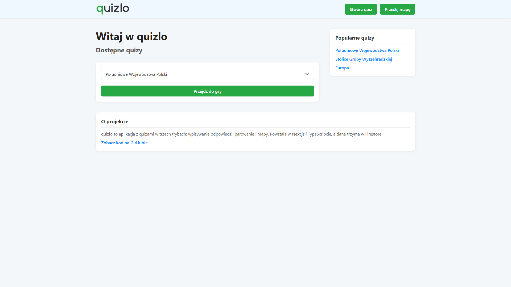
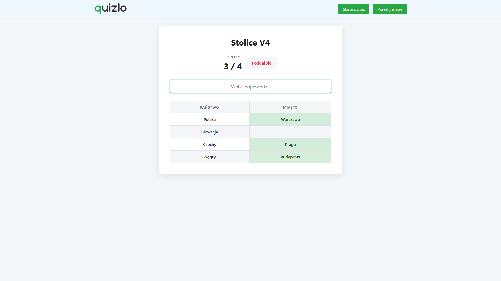
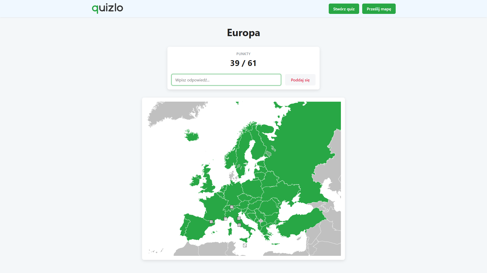
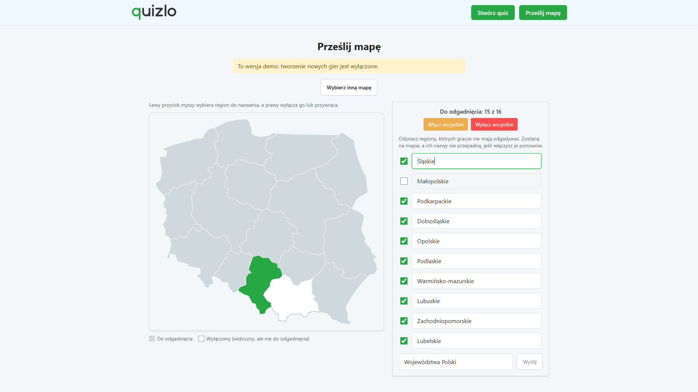

# quizlo

> **PL:** quizlo to aplikacja z quizami po polsku. Są trzy tryby: wpisywanie odpowiedzi, parowanie i odgadywanie regionów na mapie. Quizy i mapy można dodawać w kreatorach. Next.js, TypeScript i Firestore.

A quiz app in Polish with typed-answer, matching and map modes. New quizzes and maps are made in the app, and the home page shows the most played ones.

**Live demo:** DEMO_URL

| Home                                    | Quiz                                        |
| --------------------------------------- | ------------------------------------------- |
|  |  |

| Map game                              | Map creator                                      |
| ------------------------------------- | ------------------------------------------------ |
|  |  |

## What it does

- **Quiz:** type every answer on the list.
- **Matching quiz:** fill in a table, like the symbol of each chemical element.
- **Map:** name the regions of an SVG map, which change color as you guess them.
- **Quiz creator:** build a quiz in a form.
- **Map creator:** drop in an SVG, then left-click a region to name it and right-click to leave it out of the game. There are three sample maps, since most people don't have an SVG lying around.

Answers don't depend on case, Polish characters or extra spaces, so `lodz` counts as `Łódź`.

## How it's built

Next.js with React, TypeScript and Firestore.

- Firestore is only accessed from the server through the Admin SDK, so no Firebase config reaches the browser.
- The forms and the API share the same Zod schemas, so they can't drift apart.
- Uploaded SVGs get rendered as markup, so they're sanitized with DOMPurify before they're stored.
- Publishing needs `ADMIN_TOKEN`. With no token set, uploads are refused and the creators are read-only, which makes it safe to run as a public demo.
- Uploads are rate limited per IP. The limit lives in memory, so it's not exact on serverless, but it slows abuse down.

Most of the code is in `src/app`: `game/[id]` has the players, `create` the creators, `api` the routes and `lib` the Firestore access, schemas and answer checking.

## Running it locally

You need Node.js and a Firebase project with a Firestore database.

```bash
git clone https://github.com/Ketnak22/quizlo.git
cd quizlo
npm install
cp .env.example .env
```

Generate a key in the Firebase console under **Project settings > Service accounts** and copy its values to `.env`:

| Variable                | Value                                                                |
| ----------------------- | -------------------------------------------------------------------- |
| `FIREBASE_PROJECT_ID`   | `project_id` from the key                                            |
| `FIREBASE_CLIENT_EMAIL` | `client_email` from the key                                          |
| `FIREBASE_PRIVATE_KEY`  | `private_key` from the key, on one line, in double quotes, with `\n` |
| `ADMIN_TOKEN`           | Any long secret. Leave it empty for read-only mode                   |

Then add the sample games and start the app:

```bash
npm run seed
npm run dev
```

It runs on [localhost:3000](http://localhost:3000). The seed writes five games and is safe to rerun, since it matches them by name. Rerunning resets their view counts.

## Scripts

| Command          | What it does                        |
| ---------------- | ----------------------------------- |
| `npm run dev`    | Start the dev server                |
| `npm run seed`   | Write the sample games to Firestore |
| `npm run backup` | Save Firestore to `backups/`        |

## License

[MIT](LICENSE). The sample maps are made from [Natural Earth](https://www.naturalearthdata.com/) data, which is in the public domain. See [scripts/seed-data/README.md](scripts/seed-data/README.md).
